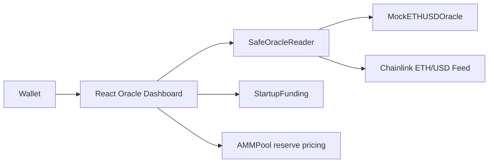

# Blockchain-Based Startup Funding and Governance Platform

## Experiment 7 - Chainlink Price Feed Oracle Integration

### Aim and objectives

Experiment 7 adds a network-aware ETH/USD reference-price layer while preserving
the existing ETH-denominated funding rules and reserve-based AMM execution.
Ganache uses the existing `MockETHUSDOracle`; Sepolia uses the official Chainlink
ETH/USD feed at `0x694AA1769357215DE4FAC081bf1f309aDC325306`.

### Architecture



`SafeOracleReader` validates positive prices, timestamps, freshness, and feed
decimals. Its `ethToUsd` result uses 18 decimal USD precision. Oracle reads are
informational and do not gate `StartupFunding.invest` or alter AMM swaps.

### Environment and commands

Copy `.env.example` to `.env` and set Sepolia values only for a real deployment:

```powershell
npm install
npx hardhat build
npx hardhat test
```

For Ganache, start Ganache on `http://127.0.0.1:7545`, then run:

```powershell
npx hardhat run scripts/deployDEX.ts --network ganache
```

For Sepolia, provide a funded test account and run:

```powershell
npx hardhat run scripts/deployChainlink.ts --network sepolia
npx hardhat run scripts/checkOracle.ts --network sepolia
```

The Sepolia script writes `deployments/sepolia-chainlink.json`; it never
overwrites the Ganache DEX configuration. A Sepolia deployment is successful
only after the deployment transaction is mined and the script reads valid feed
data from the deployed reader.

Run the frontend with:

```powershell
cd frontend
npm install
npm run build
npm run dev
```

The frontend selects the reader by wallet chain ID:

- Ganache (`1337`): the deployed mock reader in `frontend/src/dexConfig.js`.
- Sepolia (`11155111`): `0x9e78cDB124703E57686E9363D3B152E2cE99e1f8`.

`VITE_SEPOLIA_ORACLE_READER_ADDRESS` may override the verified Sepolia address,
and `VITE_SEPOLIA_STARTUP_FUNDING_ADDRESS` enables the optional Sepolia funding
screen when a real deployment address is available. Do not commit `.env` files
or private keys.

### Frontend dashboard features

The Oracle Dashboard reads the current ETH/USD price, feed description,
decimals, update time, data age, and freshness from `SafeOracleReader`. Founder
and investor screens show current-price USD estimates alongside ETH amounts;
these are not historical investment valuations. Oracle errors are displayed
without blocking ETH funding.

DEX screens continue to calculate swaps and liquidity from AMM reserves. The
Chainlink value is shown only as a reference price and, where comparable, a
deviation percentage. It never replaces AMM execution pricing. Unsupported
networks, disconnected wallets, stale data, unavailable readers, and RPC
failures are surfaced as UI states.

### Testing and limitations

The oracle tests use a local `MockAggregatorV3`; they do not depend on network
access. They cover valid data, precision, stale/future/zero/negative values,
invalid feed configuration, and conversion. Existing DEX, funding, vault,
staking, and yield-farm tests remain part of the full suite.

Compilation and tests do not constitute a production security audit. Remaining
requirements include independent contract review, monitored oracle parameters,
deployment verification, funded testnet testing, and production operational
controls. Current USD values are live reference valuations, not historical
investment prices.

A decentralized Web3 platform enabling startup crowdfunding, DAO-based governance, and simulated decentralized finance (DeFi) mechanisms including **Protocol Token Staking** and **LP Token Yield Farming**.

---

## Table of Contents

1. [Platform Overview](#platform-overview)
2. [DeFi Experiment 5 — Part 1: LP Token Yield Farming](#defi-experiment-5--part-1-lp-token-yield-farming)
   - [What Yield Farming Simulates](#what-yield-farming-simulates)
   - [Difference Between LPT Staking and Protocol-Token Staking](#difference-between-lpt-staking-and-protocol-token-staking)
   - [Farming Rewards vs AMM Trading Fees vs Impermanent Loss](#farming-rewards-vs-amm-trading-fees-vs-impermanent-loss)
   - [Contract Architecture](#contract-architecture)
   - [Reward Calculation Formula](#reward-calculation-formula)
3. [Smart Contracts Summary](#smart-contracts-summary)
4. [Deployment Steps](#deployment-steps)
5. [Ganache and MetaMask Configuration](#ganache-and-metamask-configuration)
6. [How to Run Automated Tests](#how-to-run-automated-tests)
7. [How to Execute Stake, Harvest, Withdraw, and Exit](#how-to-execute-stake-harvest-withdraw-and-exit)
8. [Diagnostic and Verification Scripts](#diagnostic-and-verification-scripts)

---

## Platform Overview

Blockchain-Based Startup Funding and Governance Platform combines decentralized crowdfunding with a shareholder voting mechanism. Founders register startups, set funding goals in ETH, and raise funds from community investors. When milestones are met or funding goals are reached, governance decisions are managed transparently via smart contracts.

---

## DeFi Experiment 5 — Part 1: LP Token Yield Farming

### What Yield Farming Simulates

In decentralized finance (DeFi), **Yield Farming** (or Liquidity Mining) incentivizes users to deposit liquidity provider (LP) tokens into a farming contract to earn protocol reward tokens (such as governance or reward tokens). 

In this educational simulation:
- **LP Token (`LPT`)** simulates a liquidity-pair token that a liquidity provider would receive after depositing assets into an Automated Market Maker (AMM) liquidity pool.
- **Reward Token (`RWD`)** represents the incentive token distributed by the protocol to yield farmers over time.
- **SimpleYieldFarm (`SimpleYieldFarm.sol`)** is the staking contract that holds the deposited `LPT`, tracks block timestamps, and calculates accrued `RWD` rewards.

> [!NOTE]
> `LPT` is an educational mock ERC-20 token simulating an LP token. There is no actual AMM pool, token pair swap, or automated liquidity rebalancing in this lab. Consequently, this simulation does **not** calculate real AMM price slippage or impermanent loss.

---

### Difference Between LPT Staking and Protocol-Token Staking

| Feature | DeFi Part 1: LP Token Yield Farming | DeFi Part 2: Protocol Token Staking |
| :--- | :--- | :--- |
| **Staked Asset** | Mock LP Token (`LPT`), representing AMM liquidity provision | Platform Token (`ABC`), representing native governance or utility |
| **Primary Economic Purpose** | Incentivize external liquidity provision to keep decentralized markets liquid | Align long-term token holders with protocol health and reduce circulating sell pressure |
| **Risk Profile in Real DeFi** | Exposed to underlying token price movements and impermanent loss (IL) | Exposed solely to the price volatility of the staked protocol asset |
| **Smart Contract** | `SimpleYieldFarm.sol` | `SimpleStaking.sol` |
| **Reward Distribution** | Harvested reward tokens (`RWD`) | Protocol reward tokens (`RWD`) |

---

### Farming Rewards vs AMM Trading Fees vs Impermanent Loss

In a production DeFi ecosystem with Automated Market Makers (e.g., Uniswap, Sushiswap):
1. **AMM Trading Fees**: When traders swap tokens through an AMM pool, a small fee (e.g., 0.3%) is collected and added to the pool reserves. Liquidity providers earn this proportional fee automatically as their LP tokens appreciate in value relative to the underlying pool reserves.
2. **Farming Rewards (Liquidity Mining)**: To bootstrap new pools, protocols distribute secondary reward tokens (`RWD`) to users who deposit their LP tokens into a farming smart contract (`SimpleYieldFarm`). This yield is an active distribution paid over time on top of trading fees.
3. **Impermanent Loss (IL)**: Occurs when the price ratio of pooled tokens changes compared to when they were deposited. If one token surges while another remains flat, arbitrageurs drain the higher-value token until prices equalize, resulting in less total value for the LP than if they had simply held both assets outside the pool.

*In this simulation, we focus specifically on the mechanics of depositing LP tokens, accounting for time-based farming reward distribution, and settling positions.*

---

### Contract Architecture

Part 1 consists of two Solidity source files:
- `contracts/MockERC20.sol`: Deployed twice — once for `LP Token` (`LPT`) and once for `Reward Token` (`RWD`).
- `contracts/SimpleYieldFarm.sol`: Manages staking, balance updates, reward calculation, harvesting, and withdrawals.

#### SimpleYieldFarm State and Mappings:
- `stakingToken`: Address of the `LPT` ERC-20 token.
- `rewardToken`: Address of the `RWD` ERC-20 token.
- `rewardRate`: Scaled reward rate (`1e15`, representing `0.001 RWD per LPT per second`).
- `stakedBalance[user]`: Current quantity of `LPT` staked by `user`.
- `lastUpdate[user]`: Block timestamp when `user` rewards were last accounted.
- `pendingReward[user]`: Stored accumulated rewards before subsequent balance changes.

#### Function Interface:
1. `constructor(address _stakingToken, address _rewardToken)`: Validates distinct non-zero token addresses and initializes the reward rate.
2. `stake(uint256 amount)`: Accrues pending rewards, transfers `LPT` into the contract, increases recorded stake, and emits `Staked(user, amount)`.
3. `earned(address user) view returns (uint256)`: Computes stored pending rewards plus newly accrued rewards since `lastUpdate[user]`.
4. `harvest()`: Updates reward accounting, clears `pendingReward`, and transfers `RWD` to the caller, emitting `RewardPaid(user, reward)`.
5. `withdraw(uint256 amount)`: Updates reward accounting, decrements recorded stake, transfers `LPT` back to caller, and emits `Withdrawn(user, amount)`.
6. `exit()`: Withdraws 100% of remaining staked `LPT` and harvests all pending `RWD` in a single transaction.

---

### Reward Calculation Formula

Rewards are computed with integer math using a scaled reward rate:

$$\text{Newly Accrued Reward} = \frac{\text{stakedBalance}[user] \times \text{rewardRate} \times (\text{block.timestamp} - \text{lastUpdate}[user])}{10^{18}}$$

$$\text{Total Earned} = \text{pendingReward}[user] + \text{Newly Accrued Reward}$$

- **Reward Rate**: $0.001 \text{ RWD per LPT per second} = 10^{15} \text{ (scaled by } 10^{18}\text{)}$
- **Example**:
  - Staked amount: $100 \text{ LPT}$ ($100 \times 10^{18}$)
  - Elapsed time: $60 \text{ seconds}$
  - Expected reward: $\frac{100 \times 10^{18} \times 10^{15} \times 60}{10^{18}} = 6 \times 10^{18} = 6.0 \text{ RWD}$

---

## Deployment Steps

### 1. Start Ganache Local Blockchain
Ensure Ganache is running on:
- **RPC Server**: `http://127.0.0.1:7545`
- **Network ID / Chain ID**: `1337` (or Ganache default `5777`/`1337`)

### 2. Deploy Part 1 Yield Farm
Run the standalone deployment script:
```bash
npx hardhat run scripts/deploy-yield-farm.ts --network ganache
```
This script:
1. Deploys `MockERC20` as `LP Token (LPT)`.
2. Deploys `MockERC20` as `Reward Token (RWD)`.
3. Deploys `SimpleYieldFarm` with LPT and RWD addresses.
4. Mints an initial 100 LPT to the deployer.
5. Funds the farm with 100,000 RWD reward tokens.
6. Writes configuration to `frontend/src/yieldFarmConfig.js`.
7. Copies the contract ABI to `frontend/src/contracts/SimpleYieldFarm.json`.

*(Part 2 deployment in `scripts/deploy.ts` and `frontend/src/contractConfig.js` remains completely separate and untouched).*

---

## Ganache and MetaMask Configuration

1. In MetaMask, add or select a custom network:
   - **Network Name**: `Ganache Local`
   - **RPC URL**: `http://127.0.0.1:7545`
   - **Chain ID**: `1337`
   - **Currency Symbol**: `ETH`
2. Import a local Ganache test account into MetaMask through Ganache's account UI. Keep private keys in ignored environment files.
   - Account Address: `0xA10989ad0b6e9BcA41693Fd588217010A5375ace`
3. In MetaMask, import the custom ERC-20 tokens:
   - **LP Token (LPT)**: Address printed in `frontend/src/yieldFarmConfig.js`
   - **Reward Token (RWD)**: Address printed in `frontend/src/yieldFarmConfig.js`

---

## How to Run Automated Tests

Run the full Hardhat test suite (includes Part 1, Part 2, and Core Funding tests):
```bash
npx hardhat test
```
The test suite includes:
- **22 automated tests for SimpleYieldFarm** (`test/SimpleYieldFarm.ts`) verifying constructor validations, staking, rewards accrual over time, partial withdrawals, harvest, full exit, underfunded farm safety, allowance checks, and reentrancy protection.
- **10 automated tests for SimpleStaking** (`test/SimpleStaking.ts`).
- **6 automated tests for StartupFunding** (`test/StartupFunding.ts`).

---

## How to Execute Stake, Harvest, Withdraw, and Exit

### Via the Web Frontend

1. Start the React frontend:
   ```bash
   cd frontend
   npm run dev
   ```
2. Open the application in your browser (e.g., `http://localhost:5173`).
3. Connect MetaMask to the local Ganache network (`1337`).
4. Click **I'm an Investor ?**.
5. In the top subnav, click **?? Yield Farming (DeFi Part 1)**.
6. Actions available:
   - **Faucet**: Click `?? Faucet: Get 100 LPT` to mint test LPT.
   - **Approve**: Enter amount to stake, then click `Step 1: Approve LPT`.
   - **Stake**: Once approved, click `Stake LPT`. Observe rewards accumulating live in real time.
   - **Harvest Rewards**: Click `Harvest Rewards (X.XXXX RWD)` to claim your accumulated RWD without unstaking.
   - **Withdraw LPT**: Switch to the **Withdraw LPT** tab, input the quantity to withdraw, and click `Withdraw LPT`.
   - **Exit & Harvest All**: Switch to the **Exit & Harvest All** tab, review summary, and click `Withdraw All & Harvest All (Exit)` to withdraw all LPT and claim all RWD in one transaction.

---

## Diagnostic and Verification Scripts

### 1. Diagnostic Script
Inspect on-chain balances, staked balances, allowances, and reward rates:
```bash
npx hardhat run scripts/check-yield-farm.ts --network ganache
```

### 2. End-to-End Automated Verification Script
Run the complete 16-step transaction lifecycle demonstration:
```bash
node --experimental-strip-types ./scripts/verify-e2e-flow.ts
```
This script exercises:
1. Minting test LPT
2. Checking LPT balance
3. Approving SimpleYieldFarm
4. Staking 100 LPT
5. Verifying staked balance
6. Fast-forwarding 60 seconds
7. Verifying ~6 RWD accrued
8. Harvesting rewards
9. Advancing 30 seconds
10. Withdrawing 40 LPT
11. Verifying wallet balance increases and remaining stake is 60 LPT
12. Checking preserved reward accounting
13. Calling `exit()`
14. Verifying final wallet balances
15. Confirming user's staked balance and pending rewards are 0
16. Confirming the farm retains its remaining reward pool


## Local DEX and Vault Lab


# StartFund

StartFund is a local Ganache demonstration of startup crowdfunding and an
ERC-4626 investor vault. Founders raise ETH through `StartupFunding`; vault
investors deposit local `sfUSD` and receive `sfVS` shares.

DEX Labs adds a local-only `WETH9` wrapper, six-decimal `MockUSDC`,
constant-product `AMMPool`, and freshness-checked ETH/USD oracle. The frontend
exposes swap, liquidity, and oracle lab cards without embedding private keys.

## Run locally

1. Start Ganache at `http://127.0.0.1:7545` with chain ID `1337`.
2. Deploy the contracts:

   ```powershell
   npx hardhat run scripts/deploy.ts --network ganache
   npx hardhat run scripts/deployVault.ts --network ganache
   npx hardhat run scripts/deployDEX.ts --network ganache
   ```

3. Copy the printed addresses (the DEX script also writes
   `frontend/src/dexConfig.js`) into
   [contractConfig.js](./frontend/src/contractConfig.js) and
   [vaultConfig.js](./frontend/src/vaultConfig.js) if Ganache was reset.
4. Start the frontend:

   ```powershell
   Set-Location .\frontend
   npm run dev
   ```

The current verified local deployment is:

- `StartupFunding`: `0x811C1540CE116D7E694Bc0e5298e746d6b3456e6`
- `MockToken`: `0xca6bd5EEA62b2C06bdcF06D5cc4DC47473a09d7a`
- `InvestorVault`: `0x517aF3df34C30037928c6f1d198e776154F74A34`
- `WETH9`: `0xdA69F6797d2AF2F685DDF30eB6a45aca22252D69`
- `MockUSDC`: `0x031ae085FfFC235a37Dc60961764E64CC0bb1A65`
- `AMMPool`: `0x398b9454CbeCfA2197d207eC0fa6E1c8B2779db9`
- `MockETHUSDOracle`: `0x73E94C3620f704351e4f059182b2474fA187455C`
- `SafeOracleReader`: `0x261Ab11ca5F6FFB1eD09C85f08B9307b678faA2e`

These addresses are valid only while this Ganache state remains unchanged.
Resetting Ganache erases the contracts and account state, so redeploy and
update the frontend addresses afterward.

`deployDEX.ts` writes the DEX addresses directly to
`frontend/src/dexConfig.js`. The DEX tokens are local test assets and the
oracle is a local simulation, not a real USDC token or Chainlink feed.

## Local sfUSD distribution

The deployer initially owns one million test tokens. To transfer some to a
Ganache account without putting private keys in the frontend:

```powershell
$env:MOCK_TOKEN_ADDRESS="0xca6bd5EEA62b2C06bdcF06D5cc4DC47473a09d7a"
npx hardhat run scripts/distributeMockToken.ts --network ganache -- 0xRECIPIENT 1000
```

## Verification

```powershell
npx hardhat build
npx hardhat test mocha
Set-Location .\frontend
npm run build
```

The project intentionally stays local. No public testnet or mainnet deployment
is part of this demonstration. The current safe scope keeps direct ETH startup
funding separate from the sfUSD vault. A startup investment/return adapter is
not enabled, because moving sfUSD out of the vault would require additional
asset-liability accounting and authorization rules.

## DAO governance (Experiment 8)

StartFund now includes a fixed-supply `GovernanceToken` (CDT) and snapshot-based
`DAOVoting` contract. Governance approval records proposal status only; it does
not transfer ETH or mark a startup funded. See [DAO implementation](docs/DAO_IMPLEMENTATION.md),
[architecture](docs/DAO_ARCHITECTURE.md), [deployment](docs/DAO_DEPLOYMENT.md),
and the [Experiment 8 test report](docs/DAO_TEST_REPORT.md).

Run `npx hardhat test mocha` to run all contract integration tests, including
the nine Experiment 8 cases. Deploy to the configured local Ganache network
with `npx hardhat run scripts/deployDAO.ts --network ganache`. The DAO script
writes a separate network manifest and frontend ABIs; set
`VITE_DAO_TOKEN_ADDRESS`, `VITE_DAO_VOTING_ADDRESS`, and
`VITE_DAO_CHAIN_ID` from that manifest in the frontend environment. Do not
reuse addresses across networks. CDT allocations are administrator-controlled;
ETH investments never automatically grant governance tokens. Each holder must
delegate before their tokens count as voting power.

