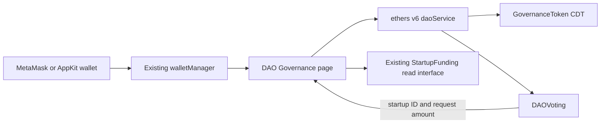

# DAO architecture

`GovernanceToken` is a fixed-supply 18-decimal CDT token using OpenZeppelin 5.2.0 ERC20, permit and votes. `delegate` creates voting checkpoints; ERC20Votes supports historical reads.

`DAOVoting` records academic or startup funding proposals. Creation requires at least 50 delegated CDT. A proposal snapshots the prior block, ends five blocks after its creation transaction, and reads `getPastVotes` at the snapshot. The snapshot prevents later transfers or delegations from changing voting weight. An address can vote once per proposal.

After the deadline, a proposal succeeds only if votes cast reach at least 4% of historical total supply (floor 40 CDT) and For exceeds Against. State values are 0 Active, 1 Defeated and 2 Succeeded. Funding proposals include the existing numeric startup ID and requested wei amount. Approval never disburses ETH.

The React page reuses the selected provider from `walletManager.js`, checks configured chain ID, and uses ethers v6. Proposal and vote records are read from the DAO contract. Startup records are read from the existing funding contract.

