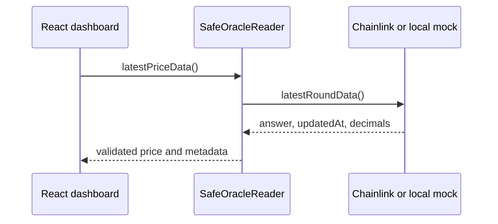

# Experiment 7 - Chainlink Price Feed Oracle Integration

## Abstract

This experiment integrates a validated ETH/USD oracle into the existing startup
funding and decentralized exchange application. Local Ganache testing retains
the existing mock feed, while Sepolia deployment targets the official Chainlink
ETH/USD feed.

## Introduction and objectives

The objective is to provide reliable live valuation without changing the
platform's ETH-denominated funding rules or the AMM's constant-product pricing.
The implementation validates price sign, timestamps, freshness, and decimals,
and exposes precise integer conversion from wei to 18-decimal USD values.

## Architecture and implementation

`SafeOracleReader.sol` is the shared consumer. `MockETHUSDOracle.sol` remains
the owner-controlled Ganache feed. `MockAggregatorV3.sol` supplies deterministic
test cases. `StartupFunding.sol` exposes an informational USD valuation helper;
`invest` remains independent of oracle availability. `AMMPool.sol` is
intentionally unchanged.

## Deployment

`scripts/deployDEX.ts` preserves Ganache deployment and synchronizes local
ABIs. `scripts/deployChainlink.ts` accepts only the configured Sepolia network,
checks the chain ID, deploys the reader, waits for confirmation, reads the
actual feed, and writes `deployments/sepolia-chainlink.json`.

No Sepolia transaction, address, price, or screenshot is claimed by this
report until a real deployment is executed.

## Testing methodology and results

The local oracle suite uses a mock AggregatorV3 implementation and covers valid
reads, decimal-aware conversion, invalid prices, stale timestamps, future
timestamps, zero timestamps, and constructor validation. The existing project
regression suite covers DEX, funding, vault, staking, and yield-farm behavior.
Final command results are recorded in `PHASE_STATUS.md`.

## Limitations and security considerations

The reader has a deployment-time immutable feed and freshness window. Feed
availability can still change on a live network, so frontend reads must handle
errors. USD values are current reference values and do not represent the
historical USD value of an earlier investment. Compilation and local tests are
not a production audit. Sepolia deployment needs a funded account, RPC
credentials, independent review, and explorer verification.

## Conclusion and future enhancements

The integration separates oracle reference data from business-critical ETH
accounting and AMM execution. Future work could add governance-controlled
parameter management, historical price snapshots, automated monitoring, and
formal verification.

## Screenshot checklist

- Ganache Oracle Lab showing the mock feed and freshness.
- Sepolia dashboard showing the deployed reader and Chainlink feed address.
- ETH-to-USD conversion result.
- Startup funding valuation alongside unchanged ETH totals.
- AMM reserve price displayed separately from the Chainlink reference price.
